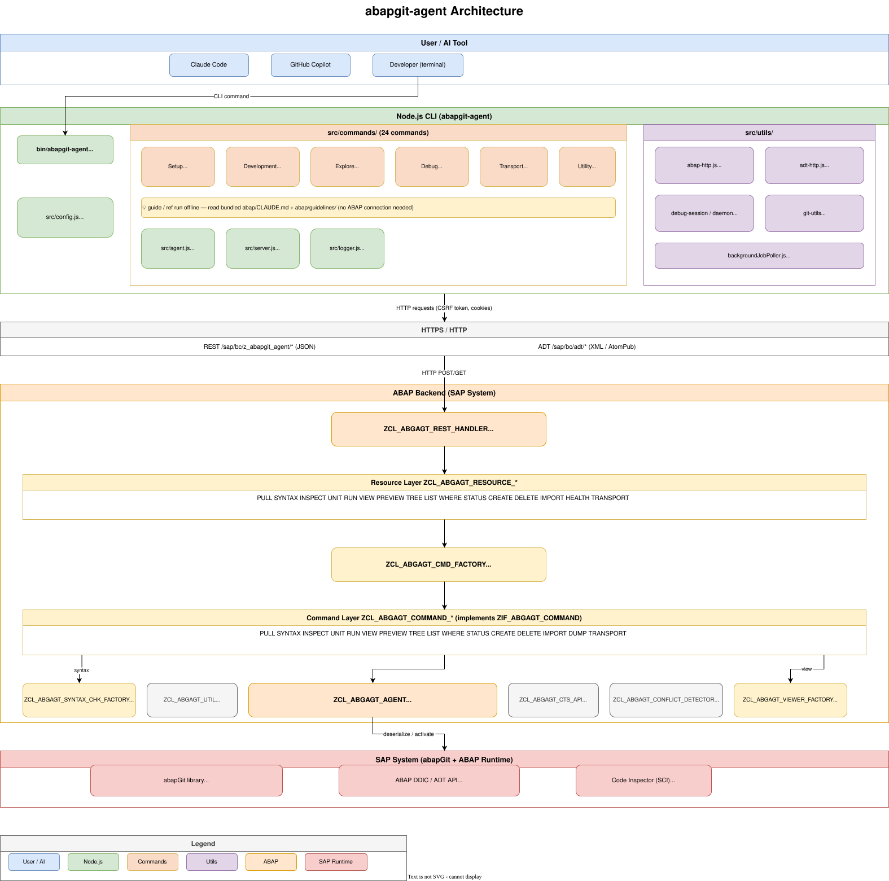

# Architecture

Internal architecture and design documents for developers and maintainers.

## System Architecture

The diagram below shows the full project architecture — from the CLI layer through to the ABAP backend and SAP system.

## Object File Handling

The [object-file handling architecture](object-file-handling.md) explains how ABAP, XML-backed, CDS and RAP files are mapped to objects for pull, drop, syntax, lint and view. It includes the shared routing diagram, command boundaries and generic source-policy seam. See the [command support matrix](../commands.md#rap-source-support) for user-facing capabilities.

The existing diagram is an architectural overview, not an exhaustive inventory of current checker/viewer types.

## Design Documents

| Document | Description |
|----------|-------------|
| [Background Job Architecture](background-job-architecture) | Asynchronous command execution with real-time progress reporting via polling — used by the `import` command |
| [Object File Handling](object-file-handling.md) | File families, object identities, pull/drop lifecycle, source policies and native/static checking paths |
