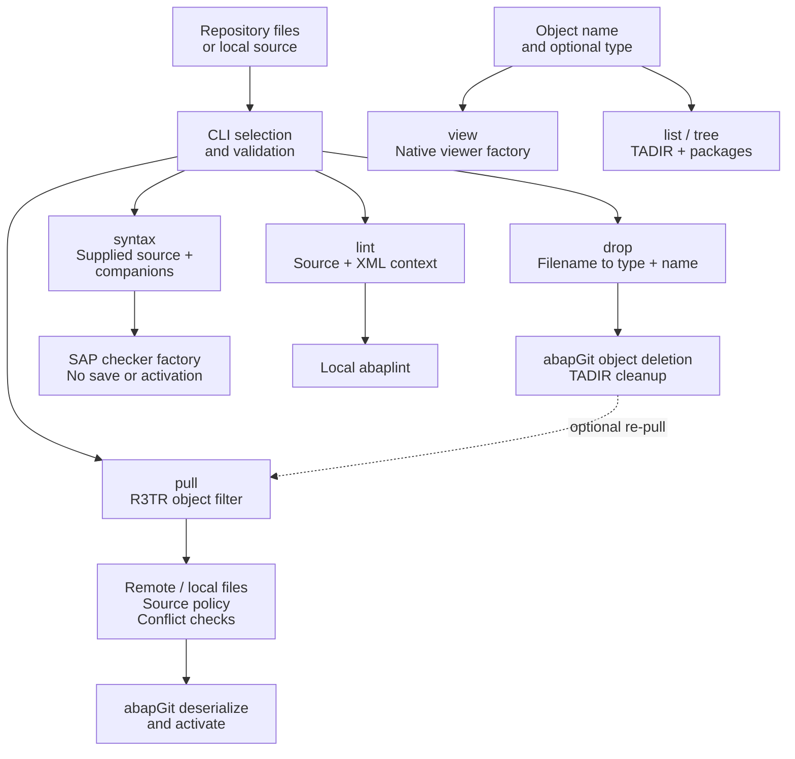

# Object File Handling

How repository files become SAP object identities, and why pull, drop and source checks handle the same files differently. This is the shared architecture for ordinary ABAP, DDIC, CDS and RAP objects—not a separate RAP framework.

For user-facing formats and capability limits, see the [command support matrix](../commands.md#rap-source-support) and individual command documentation.

## File, object and command are different boundaries

1. **File representation:** abapGit serializes an object into source, XML metadata and sometimes multiple companions.
2. **Object identity:** a selector is translated into `(type, name)`, typically an `R3TR` TADIR identity. A file does not necessarily represent an independently activatable/deletable object.
3. **Command capability:** parsing an identity does not prove that syntax, lint, view or SCI can process that type. Each command has its own input and dispatch contract.

The paths are intentionally separate. Pull reads repository content; syntax checks supplied local text; drop uses a filename as an identity, not as deletion content. The diagram's re-pull arrow represents the helper call after deletion, not a guarantee that every selector passes the normal pull CLI validation.

## File families

| Family | Typical abapGit files | Identity and handling |
|---|---|---|
| ABAP source | `name.clas.abap`, `name.intf.abap`, `name.prog.abap` plus XML | Source and metadata describe the same object. Syntax dispatch is type-specific. |
| Class companions | `name.clas.locals_def.abap`, `.locals_imp.abap`, `.testclasses.abap` | Belong to the parent CLAS. Syntax assembles applicable companions; they are not separate objects to delete. |
| Function groups / enhancements | Specialized FUGR source sets; `name.enho.<hash>.abap` | Require existing command-specific handling. Do not assume every serialized companion is a valid standalone selector. |
| XML-backed objects | `name.tabl.xml`, `name.dtel.xml`, `name.ttyp.xml`, etc. | XML provides the object representation/identity. It is not ABAP source text for syntax or lint. |
| CDS | `name.ddls.asddls`, `name.dcls.asdcls` plus XML | Native source suffix and object type matter. DDLS is lintable; DCLS has native syntax handling but no supported abaplint source parser. |
| RAP declarations | `name.bdef.asbdef`, `name.srvd.srvdsrv` (legacy `.assrvd`), `name.ddlx.asddlxs` plus XML | Strict type/suffix matching; additional pull source-safety rules described below. |
| Repository / auxiliary files | `.abapgit.xml`, package metadata, `.baseinfo`, other serializer companions | abapGit repository/lifecycle context; not a promise of standalone syntax, lint or drop support. |

For the strict RAP formats, both Node and ABAP normalize the basename and encoded namespace (`#namespace#name` → `/namespace/name`), uppercase the identity, and enforce a 30-character decoded-name limit. That is an agent parsing limit, not a universal SAP object-name rule. Legacy formats retain their existing parsing behavior.

`src/config.js` implements exclusion/type classification, not a universal command registry. The shared Node parser, backend parser, source policy and command filters have different responsibilities and are not interchangeable allowlists.

## Pull: select an object, import its representation

1. The CLI validates selectors and exclusions. Ordinary source and appropriate XML selectors are accepted; selective RAP pull requires its **native source**, not the XML companion. Local existence is checked unless an explicit repository URL is supplied. DTEL XML also has label-length preflight validation.
2. The backend parses selectors into object identities and builds an abapGit object filter. Where supported by the installed abapGit, directory paths also prune Git tree fetching.
3. The generic agent obtains remote files and serialized local files, delegates source-policy validation, and builds object-keyed conflict entries.
4. Existing abapGit deserialization and activation import the selected objects. This is not an arbitrary single-file upload: object metadata and companions remain abapGit's responsibility.
5. Conflict baselines are stored only on the successful pull path.

Full repository pulls use the existing lifecycle without explicit file selectors. Neither path adds automatic RAP dependency resolution or behavior-pool selection.

### Conflict representation is narrower than serialization

The conflict index is keyed by **object type and name**, with source preferred over companion XML. It is not a hash of every serialized file in the object:

- Class local/test companions are skipped as independent conflict entries. Complete class-companion conflict bundles are not implemented.
- The current default policy admits `.abap`, `.asddls`, `.xml` and the native RAP suffixes into this path; `.asdcls` is not admitted as a source entry. DCLS parsing/pull support must not be confused with complete DCLS source-conflict coverage.
- Package metadata is excluded from object baselines.
- Source content follows the installed abapGit serializer's version behavior; it is not a general guarantee of protecting every inactive/draft variant.

`--conflict-mode ignore` skips conflict comparison, **not** source-policy validation. A first pull without a baseline likewise still has source guards. See [conflict detection](../development/pull-conflict-detection.md).

## RAP is a source-policy case, not agent orchestration

`ZCL_ABGAGT_AGENT` accepts a generic `ZIF_ABGAGT_SOURCE_FILE_POLICY`, defaulting to `ZCL_ABGAGT_SOURCE_FILE_POLICY`. The agent asks the policy about source eligibility, fetched/local file validation and read/decode failures; it does not contain RAP-named orchestration or a per-type policy registry.

The default implementation privately requires, per BDEF/SRVD/DDLX identity:

- exactly one native source in the fetched representation and in existing selected local representations;
- valid type/suffix/name pairing, rather than treating XML alone as sufficient source;
- no silent choice between duplicate sources—canonical and legacy SRVD sources together count as two;
- failure before deserialization when required local source cannot be read or selected source cannot be decoded as UTF-8.

The policy validates already-fetched files. It does not fetch, activate, store baselines or interpret command responses. Ordinary object behavior is retained; the strict source family does not require a new pull framework.

BDEF procedural implementation is a separate CLAS/behavior pool. SRVB editing/publication, dependency ordering, inactive viewing and complete class-companion conflict protection remain outside this design.

## Drop: delete the object, not the file

The CLI requires a local selector file, derives its identity and sends the file path to the backend. The backend re-parses it, looks up the exact TADIR identity/package, delegates object deletion to abapGit, removes the TADIR entry and commits the deletion. It does not upload or delete the local source file.

Deleting via a class companion still targets its parent CLAS; deleting a RAP declaration does not imply cascade deletion of its dependency graph. DTEL deletion is explicitly rejected because of reactivation limitations.

`drop --pull` calls the pull helper **after successful deletion**. RAP requires a native source selector: XML with `--pull` is rejected before deletion so the re-pull cannot store an XML conflict baseline. Standalone RAP XML drop remains accepted. Deletion and re-pull are not an atomic operation. See [drop](../development/drop-command.md).

## Checking and reading are separate dispatch paths

| Path | What it consumes | Dispatch / limit |
|---|---|---|
| `syntax` | Supplied source, with applicable CLAS/FUGR grouping and metadata options | Existing `ZIF_ABGAGT_SYNTAX_CHECKER` and dynamic factory. Native RAP adapters share `ZCL_ABGAGT_RAP_SYNTAX_UTIL`; Workbench checks replace source in memory with commits disabled. No save/activation; activated dependencies may still be required. |
| `lint` | Local `.abap`, `.asddls`, `.bdef.asbdef`, `.ddlx.asddlxs` and XML context | Local abaplint, not SAP semantics. Native parser rules enabled when omitted; explicit `false` respected. SRVD/DCLS are excluded; engine/report failures cannot become fabricated clean results. |
| `view` | Object identity, optional format/sections | Existing native viewer factory; BDEF/SRVD/DDLX read active source. Use explicit type when names collide. |
| `inspect` | Repository selectors / SAP object identities | Existing DDLS/SCI handling; recognition and zero findings do not establish that a variant executed relevant checks. No complete RAP SCI coverage claim. |
| `list` / `tree` | TADIR filters / package hierarchy | Generic catalog handling, not local file parsing or a RAP BO graph. |
| `where` | Object identities | Supported targets remain CLAS/INTF/PROG; other targets receive explicit unsupported-type errors. |

See [syntax](../development/syntax-command.md), [lint](../development/lint-command.md), [view](../explore/view-command.md) and [inspect](../development/inspect-command.md) for their detailed contracts. Supporting a type in one row does not enable the other rows.

## Implementation and validation boundaries

| Responsibility | Entry points |
|---|---|
| Node identity and exclusions | `src/utils/validators.js`, `src/config.js` |
| CLI selectors / supplied-source preparation | `src/commands/pull.js`, `src/commands/drop.js`, `src/commands/syntax.js`, `src/commands/lint.js` |
| Backend identity | `abap/zcl_abgagt_util.clas.abap` |
| Pull/deletion orchestration | `abap/zcl_abgagt_agent.clas.abap` |
| Generic source-policy contract / default | `abap/zif_abgagt_source_file_policy.intf.abap`, `abap/zcl_abgagt_source_file_policy.clas.abap` |
| Native checking/reading | Existing syntax/view factories and type-specific adapters; `abap/zcl_abgagt_rap_syntax_util.clas.abap` |

Keep tests at those boundaries: parser parity, command routing and rejection, direct policy tests, an injected-policy agent test, and native supplied-source/preservation tests. Mocked parser/dispatch tests do not prove SAP activation or SCI coverage. See [integration tests](../integration-tests.md).

For self-hosted backend changes, no-write syntax-check first, deploy additive interfaces/policies/helpers/viewers/checkers before consumers, and pull the generic agent's main/XML/all companions together **last**. Stop on a failed stage and verify health before importing the new object family. Do not replace this staged rollout with an unrestricted pull-all.
